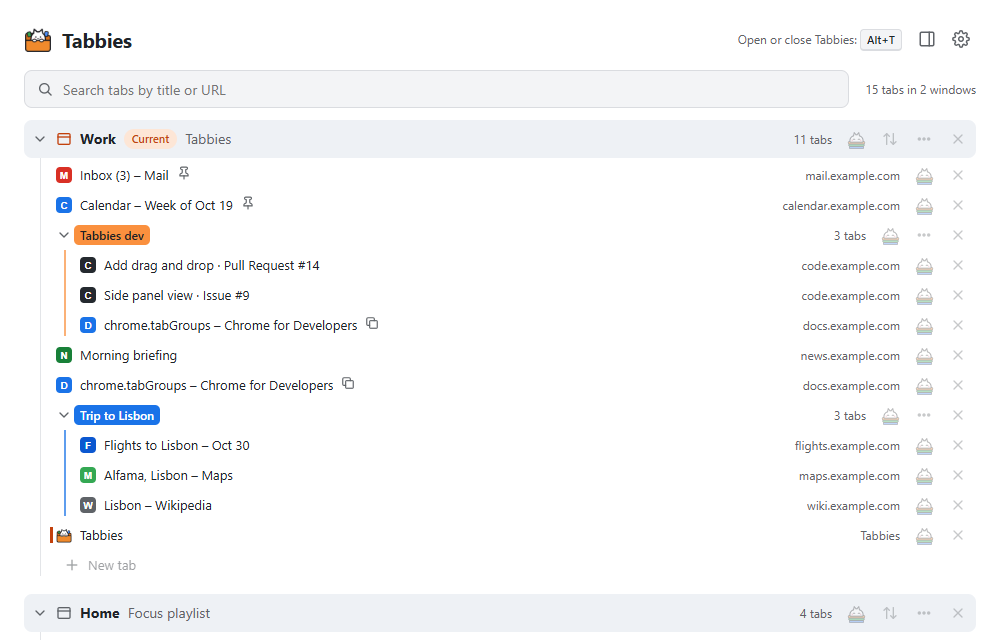
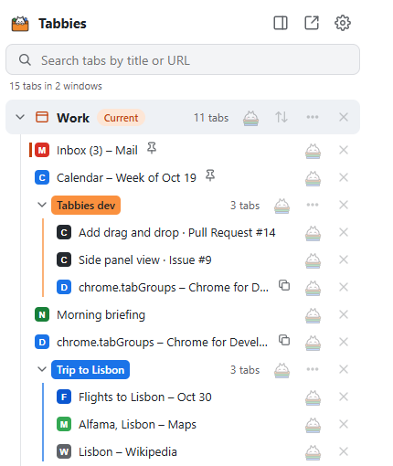
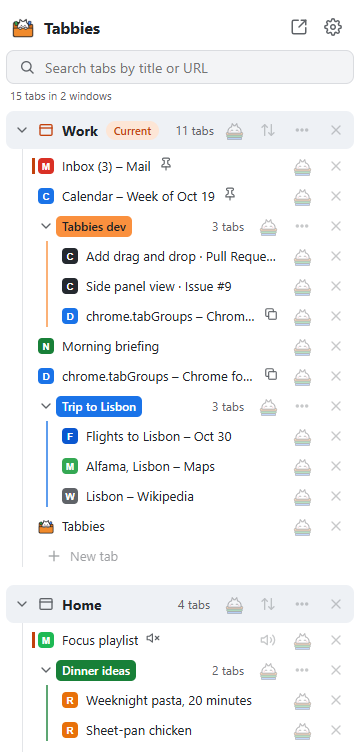
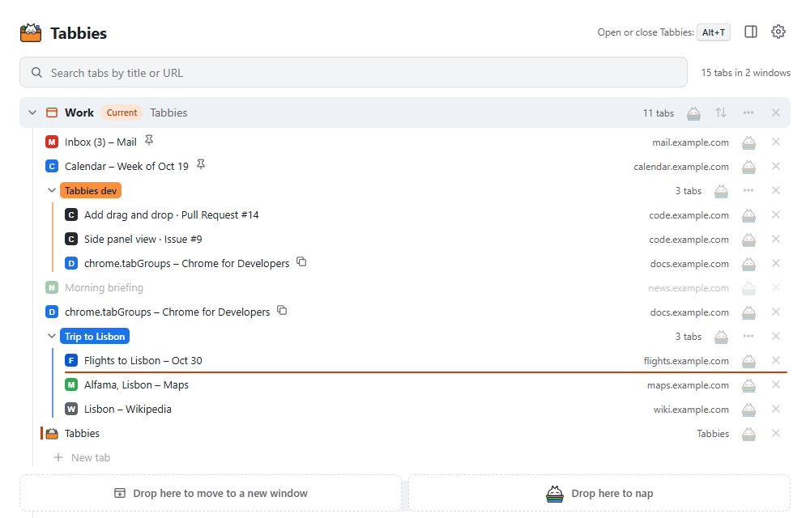

# Tabbies

A file-explorer-style tab manager for Chrome. Tabbies shows every open window, tab group and tab as a tree. You can find, switch to, mute and close tabs, and drag them between groups and windows like files between folders.

**Status:** v0.4, an early preview. Everything stays in your browser: no servers, no accounts.



## Features

### Three views, one explorer

| Mini popup | Side panel |
| --- | --- |
|  |  |

- **Full tab** (the default): click the Tabbies icon in the toolbar, or press **Alt+T**. If Tabbies is already open in a tab, you're switched to it instead of getting a second copy. Press it again on the Tabbies tab to go back to the tab you came from.
- **Side panel:** stays open on the right while you browse. Open it with the side-panel button in the Tabbies tab, or choose it in Settings as what the icon opens (then Alt+T opens and closes the panel).
- **Popup:** a small window under the icon. Choose it in Settings if you prefer it.

All three share the same code and features. The layout adapts to the space: narrow views hide the site column.

### Settings

Click ⚙ in any Tabbies view, or right-click the Tabbies icon → **Options**. Changes apply right away, in every open Tabbies view, and follow your Chrome profile to your other computers (Chrome Sync).

- **Toolbar icon:** what clicking it opens: a full tab (default), the side panel, or a popup.
- **Theme:** match your computer, light or dark.
- **Tabbies tab:** keep it pinned.
- **Naps:** keep links after waking; nap pinned tabs too.
- **Keyboard shortcuts:** see the current keys and open Chrome's page to change them.
- **Sync naps with your Chrome profile** (off by default): see below.
- **Naps backup:** download your naps as a text file, or restore from one.

### Tree view

- Windows → tab groups → tabs. Click the arrow (or double-click the row) to expand or collapse a window or group.
- **＋ New tab** at the end of each window and **＋ New window** after the last one (also in the right-click menus).
- **Clicks work like files and folders on a desktop:** one click selects, a double-click opens. Double-click a tab to switch to it; one click on a window or group selects it with all its tabs.
- Windows show their tab count, and the window you opened Tabbies from is marked **Current**.
- **Name your windows** ("Work", "Dinner plans"…) like folders: select the window, click its name and type, then Enter or just move the mouse away (Esc cancels). F2 or the window's ⋯ menu work too. Names stay after Chrome restarts, as long as the window comes back with mostly the same tabs. Naps are renamed the same way.
- Close a whole window with the ✕ on its row or from its ⋯ menu. Undo brings it back.
- Groups show their name and Chrome color.
- Tabs show the site icon, title and site, plus small icons for **playing sound**, **muted**, **pinned** and **asleep** (unloaded by Chrome to save memory).
- **Search** by title or URL as you type. Windows and groups with no matches are hidden.
- **Live updates:** the tree follows every change you make anywhere in Chrome.
- **Hover card:** rest the mouse on a tab for a moment to see its full title and address, when you last used it, whether it's asleep, pinned or playing sound, its window and group, and whether it's open more than once. Napped links show which nap they're in.
- **Page previews** (optional, Settings → Page previews): the hover card also shows a snapshot of the page. Chrome only lets extensions photograph the tab you're looking at, so a tab gets its preview the next time you look at it. Until then its card says "No preview yet". If a site has since moved to another page (YouTube, Gmail…), the card shows the earlier snapshot and says so. Settings shows how many snapshots there are, and warns if Chrome's permission went missing.
- A window's row stays at the top while you scroll through its tabs, so you always see which window you're in.
- **Tips:** each time Tabbies opens, a small tip under the search box shows one thing worth knowing: how the clicks work, your key for opening Tabbies (as you've set it in Chrome), the side panel and popup views, Ctrl+Z, ? for all shortcuts, and more. **Got it** retires that tip and shows the next, **Next** skips to another, **✕** closes the banner until next time, **Hide tips** turns them off. Settings → Tips turns them back on, or brings back every tip you retired.
- **Light and dark mode** follow your system setting.

### Tab actions

Double-click a tab (or press Enter on it) to switch to it; its window comes to the front.

Each row keeps just its main buttons, always faintly visible and brighter under the mouse: **nap** and **close** on tabs (plus **unmute/mute** on tabs that play sound), **nap**, **⋯** and **close** on groups, plus **sort** (⇅) on windows.

**Right-click any row** for everything else, like on a desktop:

- **Tabs:** Switch to this tab, Nap, Put in a new group, Ungroup and the group's color (for grouped tabs), New tab to the right, Duplicate, Move to a new window, Pin/Unpin, Mute, Reload, Sleep, Close its duplicates (for a duplicate), Close. Right-clicking a selected tab acts on the whole selection.
- **Groups:** Rename, color, New tab in group, Ungroup, Close.
- **Windows:** Nap, Sort tabs…, New tab, New window, Sleep other tabs, Close duplicate tabs (when there are some), Rename, Close.
- **Empty space:** New window, Nap every window, Close duplicate tabs everywhere.

**Sleep** unloads tabs to free memory: they stay in the tab strip (dimmed here, with a moon) and load again when you open them. The tab you're looking at and tabs playing sound stay awake.

**Duplicates:** a tab whose page is open more than once (in any window) shows a small two-pages icon; its tooltip says how many. **Close duplicate tabs** keeps one of each page (a pinned one, or the one you're looking at, if any) and closes the rest, with Undo.
- **Naps and napped links:** the same as their ⋯ menu; Wake or Delete for links.

Right-clicking something that isn't selected selects it first.

### Selecting several tabs

Select tabs the way you select files:

- **Click** a tab to select just that tab. Click a window or group to select everything in it. Click a selected item again to unselect it.
- **Ctrl+click** (⌘+click on a Mac) adds or removes one tab, or a whole window or group.
- **Shift+click** selects every tab from the last one you clicked to this one, across groups and windows. Shift+click a group or window to take the range through all of it. **Ctrl+Shift+click** adds that range to what's already selected.
- **Shift+↑/↓** extends the selection from the keyboard. **Ctrl+A** selects every tab you can see, so search first to select all matches.
- **Esc**, **Cancel**, or clicking anywhere that isn't a row clears the selection.
- The bar that appears while tabs are selected offers **Nap**, **Group**, **New window** and **Close** (with Undo). When some of them are in tab groups, it also offers **Ungroup** (takes just those tabs out; Undo puts them back) and **Color** (recolors their groups).
- **Group** puts the selected tabs into a new tab group, together in the window of the first one (pinned tabs get unpinned, since groups can't hold them). Type a name for it right away, or press Enter to leave it unnamed; Undo puts every tab back.
- Rename any tab group by clicking its name once it's selected, like a window's. A group's ⋯ or right-click menu also changes its **color**, **ungroups** it (the tabs stay open) or **closes** it; its ✕ closes it too. All of these can be undone.
- A window's ⋯ menu also has **Nap this window**, same as its cat button.
- Tabs you multi-selected in Chrome's own tab strip start out selected.

Drag any selected tab and **all selected tabs move together**, as one block in their original order. The drop rules below apply to the whole block.

Selected rows that sit next to each other join into one blue block. The tab each window is currently showing has a small orange bar beside its icon.

### Sorting a window

Click the sort button (⇅) on a window's row, or choose **Sort tabs…** from its ⋯ or right-click menu:

| Sort | What it does |
| --- | --- |
| By site | Tabs from the same site sit together (all YouTube, all Gmail…), sites A–Z |
| By title | A–Z |
| Recently used first | The tabs you looked at last come first |
| Oldest first | Tabs you haven't opened in a while come first, to help you clean up |

Groups stay together: tabs are sorted inside each group, and the ungrouped tabs are sorted after the groups. Pinned tabs don't move. Click **Undo** in the message that appears to put the window back as it was.

### Naps: close tabs now, open them later


**Napping** saves tabs to a list in the **Naps** section and closes them, freeing their memory. **Waking** opens them again.

- **Nap** with the Tab Nap cat button on a tab, a group or a window, or select tabs (Ctrl/Shift+click) and press **Nap** in the bar that appears. You can also drag tabs, groups or windows onto **Drop here to nap**, onto the Naps section (new nap), or onto an existing nap (adds to it).
- **Nap from anywhere:** press **Alt+N** to nap the tab you're looking at, or **Alt+W** for every tab in the window. Right-clicking the Tabbies icon offers **Nap this tab**, **Nap all tabs in this window** and **in every window**. The icon briefly shows how many tabs were napped.
- Napping a window or every window leaves pinned tabs and Tabbies itself open. Empty new tabs have nothing to save, so they are simply closed along with the nap (Undo brings them back too). Incognito tabs are never napped, so incognito addresses are never saved.
- A nap is named by its date, or after the tab group it came from (with the group's color). Rename it from its ⋯ menu.
- **Wake** a whole nap with its ☀ button: here, or as a group if it came from one. The ⋯ menu also offers **Wake as a group** and **Wake in a new window**. Double-click a single link to open just that tab.
- Woken links leave the nap, and an empty nap disappears. To keep them instead, turn on **Keep links after waking** in the Naps ⋯ menu.
- **Drag naps around like files:** drag a nap, or one or more links, onto a window, between tabs, onto a tab group or onto **new window**, and they wake right there. A nap that came from a tab group wakes as that group. Inside Naps, drag links to reorder them or move them to another nap (onto the Naps heading makes a new nap), and drag naps to reorder them.
- **Select links** with Ctrl/Shift+click like tabs (or click a nap to select all of it); the bar that appears offers **Wake**, **New window** (wake them in a new window) and **Delete**. The same are in the right-click menu.
- Every nap, wake and delete shows an **Undo** button. To clear everything, the Naps ⋯ menu has **Delete all naps…**, which asks first.
- Search finds napped tabs too.

**Import and export:** the Naps ⋯ menu has **Import links…** and **Export links…**. The text has one `URL | Title` per line, with a blank line between naps, so you can keep it as a backup or bring in lists from other tab tools that use this format.

**Syncing naps between computers.** Naps are kept on this computer unless you turn on **Settings → Sync naps with your Chrome profile** (do it on each computer). Tabbies then keeps them in a **Tabbies Naps** folder under *Other bookmarks*, and Chrome Sync brings them to every computer signed in to the same Chrome profile. Good to know:

- Chrome asks you to let Tabbies "read and change your bookmarks" when you turn it on. Nothing is asked when you install Tabbies.
- Napped pages also appear in your bookmarks, in address-bar suggestions, and on your phone if it syncs bookmarks. The ☆ in the address bar shows them as bookmarked.
- A nap from a tab group keeps its color as a dot at the end of the folder name, e.g. "Reading 🟣". Please don't rearrange the folder by hand; deleting it there deletes those naps on every computer.
- Turning sync off copies the naps back to this computer and leaves the bookmarks folder alone, so your other computers keep theirs.

Without sync, removing the extension deletes your naps, so download a backup first (Settings → Naps backup).

### Drag and drop



| Drag a… | onto… | and it… |
| --- | --- | --- |
| tab | another tab | moves just above or below it, joining that tab's group (if any) |
| tab | a group's row | joins the end of the group (drop on the top edge of the row to place it just before the group instead) |
| tab | a window's row | moves to the end of that window |
| group | another group or tab | moves above or below it as a whole, keeping its name and color |
| group | a window's row | moves to the end of that window |
| tab or group | **Drop here to move to a new window** | opens in a new window |
| window | another window's row | **merges**: all of its tabs move over, in order, groups intact, and the empty window closes |

- A line shows where the item will land. Its indent tells you whether it will be inside a group.
- Hover a collapsed window or group for a moment while dragging to open it.
- Tabs are never reloaded or closed when moved: pages keep their scroll position, typed text and sound. Pinned tabs stay pinned.
- Chrome doesn't allow some moves, so Tabbies won't offer them: between incognito and regular windows, putting pinned tabs into groups, or mixing pinned and unpinned tabs.

### Keyboard

| Key | What it does |
| --- | --- |
| <kbd>Alt</kbd>+<kbd>T</kbd> | Open or close Tabbies: same as clicking its icon (the Tabbies tab, or back to where you were, unless Settings says otherwise) |
| <kbd>Alt</kbd>+<kbd>N</kbd> | Nap the tab you're looking at |
| <kbd>Alt</kbd>+<kbd>W</kbd> | Nap all tabs in the current window |
| <kbd>F2</kbd> on a window, group or nap row | Rename it |
| <kbd>/</kbd> | Jump to the search box |
| <kbd>Enter</kbd> in search | Switch to the first matching tab |
| <kbd>Esc</kbd> in search | Clear the search |
| <kbd>↑</kbd> <kbd>↓</kbd> | Move between rows (<kbd>↓</kbd> from search enters the tree) |
| <kbd>←</kbd> <kbd>→</kbd> | Collapse / expand a window or group |
| <kbd>Enter</kbd> on a row or button | Switch to the tab, wake the link, or press the button |
| <kbd>Shift</kbd>+<kbd>↑</kbd> <kbd>↓</kbd> | Extend the selection |
| <kbd>Ctrl</kbd>+<kbd>A</kbd> | Select all visible tabs |
| <kbd>Esc</kbd> | Clear the selection |
| <kbd>Space</kbd> on a row | Select or unselect it |
| <kbd>N</kbd> | Nap the selected tabs (or the focused one) |
| <kbd>Ctrl</kbd>+<kbd>G</kbd> | Put the selected tabs in a new group |
| <kbd>Ctrl</kbd>+<kbd>Shift</kbd>+<kbd>G</kbd> | Take the selected tabs out of their groups (select a group to ungroup all of it) |
| <kbd>Del</kbd> or <kbd>Backspace</kbd> | Close the selected tabs, or delete the selected napped links |
| <kbd>Ctrl</kbd>+<kbd>Z</kbd> | Undo the last close, nap, group, ungroup, sort… (several steps back) |
| <kbd>Ctrl</kbd>+<kbd>Y</kbd> or <kbd>Ctrl</kbd>+<kbd>Shift</kbd>+<kbd>Z</kbd> | Redo what you just undid |
| <kbd>Shift</kbd>+<kbd>F10</kbd> or the Menu key | Open the right-click menu of the focused row |
| <kbd>?</kbd> | Show all keyboard shortcuts (also: right-click empty space → Keyboard shortcuts) |

On a Mac, use ⌘ for Ctrl and ⌫ for Del. The right-click menus show these keys next to their items.

Alt+T, Alt+N and Alt+W work anywhere in Chrome; change them at `chrome://extensions/shortcuts` (Settings → Keyboard shortcuts takes you there). The others work inside Tabbies.

## Install (developer mode)

1. Download or clone this repository.
2. In Chrome (version 123 or newer), go to `chrome://extensions`.
3. Turn on **Developer mode** (top-right corner).
4. Click **Load unpacked** and pick the `Tabbies` folder (the one that contains `manifest.json`).
5. Click the puzzle-piece icon in the toolbar and pin Tabbies.
6. Click the Tabbies icon or press **Alt+T** to open Tabbies in a tab.

After you change the code, click the reload button (↻) on the Tabbies card in `chrome://extensions`. Reloading closes any open Tabbies tabs and panels, so open them again.

To include incognito windows, open **Details** on the Tabbies card and turn on **Allow in Incognito**.

## Permissions

- `tabs`: read the titles, addresses and icons of open tabs, and move them. Chrome lists this as "Read your browsing history".
- `tabGroups`: read, move and recreate tab groups.
- `sidePanel`: show Tabbies in Chrome's side panel.
- `storage`: keep your naps and settings (settings sync with your Chrome profile).
- `unlimitedStorage`: lets naps grow past Chrome's usual 10 MB limit for an extension (tens of thousands of saved links). Chrome shows no warning for it.
- `contextMenus`: the Nap items when you right-click the Tabbies icon.
- `bookmarks` (optional, asked only if you turn on **Sync naps**): keep naps in a synced bookmarks folder.
- Access to all sites (optional, asked only if you turn on **Page previews**): take a small snapshot of the page you're looking at, for the hover card. Chrome lists this as "Read and change all your data on all websites". Turning previews off gives it back.

Unless you turn on Page previews, Tabbies never reads page content. It never sends your data anywhere: snapshots stay in memory on your computer and are forgotten when Chrome closes. Site icons are loaded from the icon address Chrome reports for each tab, usually straight from the browser cache. The full privacy policy is in [PRIVACY.md](PRIVACY.md).

## Project layout

```
manifest.json          Extension settings: permissions, side panel, options page, shortcuts
background.js          Service worker: what the toolbar icon opens, keyboard shortcuts
tabbies.html/.js       Full-tab view
sidepanel.html/.js     Side panel view
popup.html/.js         Mini popup (if chosen in Settings)
settings.html          Chrome's Options page for Tabbies (settings-page.js)
shared/
  chrome-api.js        Chrome API calls: reading tabs, tab actions, moving, sorting, opening views
  naps-api.js          Chrome API calls for Naps: saving, closing, reopening, import/export, sync on/off
  naps-store.js        Where naps are kept: this computer, or a synced bookmarks folder
  settings-api.js      Chrome API calls for settings and the toolbar icon behavior
  nap-data.js          Naps helpers with no Chrome calls: names, import/export text format
  explorer.js          Explorer UI (search + tree). Makes no chrome.* calls itself
  settings.js          Settings page UI. Makes no chrome.* calls itself
  drag-drop.js         Drag and drop: works out what was dropped where
  sorting.js           The sort orders (by site, title, last used)
  start-view.js        Start-up shared by the three views (explorer, Settings, theme)
  dom.js               Tiny element builder used by the UI files
  theme-boot.js        Applies a fixed Light/Dark theme before the page is drawn
  explorer.css         Explorer styles
  settings.css         Settings page styles
  view.css             Page layout for each view
  theme.css            Colors and fonts for light and dark mode
  icons.js             Small inline SVG icons
icons/                 Extension icons (icon.svg is the source for the PNGs),
                       nap.svg / nap-small.svg (the Tab Nap cat for Naps)
shared/previews-api.js Optional page previews: snapshots for the hover card
package.ps1            Builds the Chrome Web Store zip (dist/)
PRIVACY.md             Privacy policy (for the Chrome Web Store listing)
store/                 Chrome Web Store listing: texts, screenshots, promo tile
docs/screenshots/      Images used in this README
```

No build step: plain HTML, CSS and JavaScript (ES modules).

## Publishing to the Chrome Web Store

1. Bump `version` in `manifest.json`.
2. Run `powershell -ExecutionPolicy Bypass -File package.ps1`. It writes `dist/tabbies-<version>.zip` with only the files the extension needs.
3. Upload that zip in the [Chrome Web Store developer dashboard](https://chrome.google.com/webstore/devconsole). The listing texts, permission justifications and images are in `store/`; the privacy policy is `PRIVACY.md`.

## Roadmap

- [x] Phase 1: full-tab view, tree, click/close/mute, search, live updates, shortcut, dark mode
- [x] Phase 2: popup and side panel views
- [x] Phase 3: task-manager actions: pin, sleep, reload, duplicate, find and close duplicate tabs (last used and Chrome's Task Manager: still to do; extensions can't open the Task Manager, press Shift+Esc)
- [x] Phase 4: select multiple tabs and move them (Ctrl/Shift selection, drag a selection); merge windows by dragging one onto another
- [x] Sorting a window by site, title or last use, with Undo
- [x] Settings page; the toolbar icon opens the full tab by default
- [x] Settings sync with your Chrome profile; optional nap sync through bookmarks
- [x] Phase 5: tab group tools (create from a selection, rename, recolor, ungroup, close)
- [x] Phase 6: drag and drop (tabs, groups and windows; to a new window; merging)
- [x] Phase 7: saved lists ("Naps") with import/export and undo
